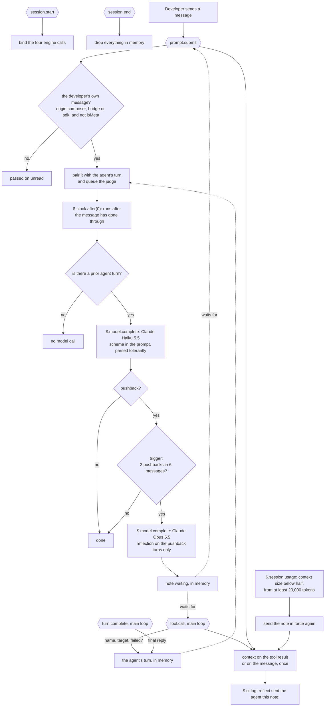
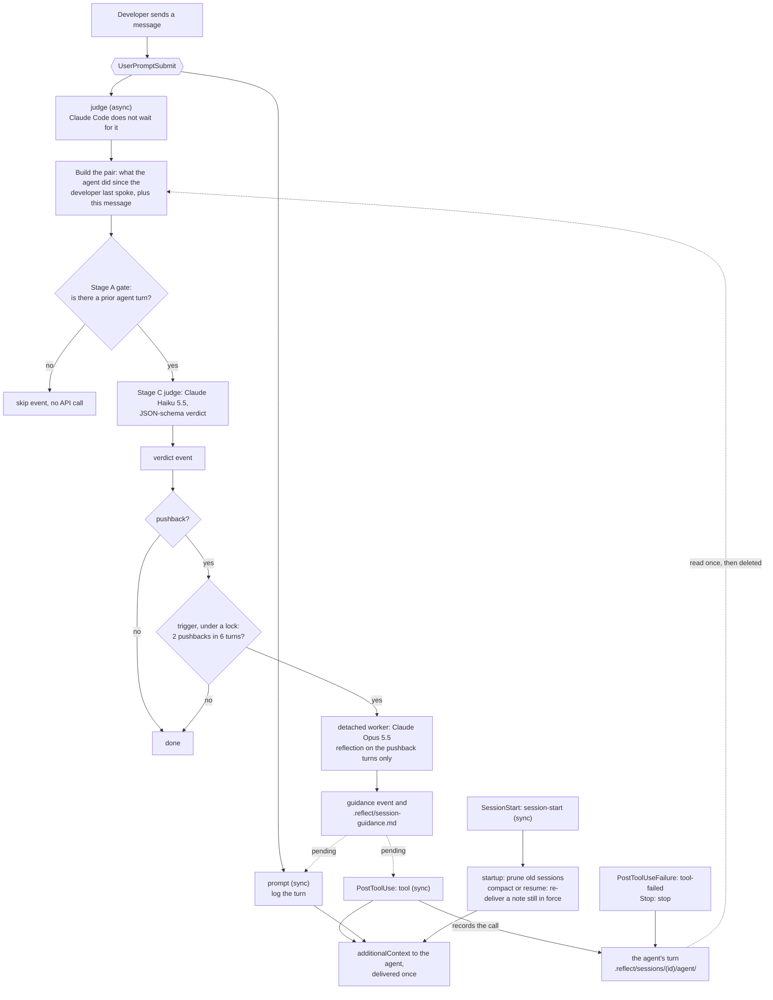

# How reflect works

reflect is a Claude Code plugin that watches how the developer responds to the agent. When two of the developer's messages in a short stretch are pushback (a correction, a rejection or a report that something is broken), a stronger model reads those turns and writes a short note. The agent receives the note before its next step.

Everything comes from one TypeScript source tree in `src/`, in two forms. Since 0.3.0 the plugin (`chanjoongx-reflect`) is a mod: Claude Code loads `plugin/hooks/reflect.ts` itself and calls it from Claude Code function hooks. `scripts/build-hook.mjs` generates that file from `src/mod/reflect.ts` and the 11 `src/` modules it imports, and it is committed. The npm package's `reflect` command, from `src/entry.ts`, is `dist/reflect.mjs`; it holds the CLI and a set of command hooks for wiring by hand, and is built when the package is packed. The installable plugin is the `plugin/` folder: the manifest, `hooks/hooks.json`, the module, the `/brain-reflect` command, the icon, the plugin's README and its privacy policy. Nothing is kept between sessions. The plugin writes nothing to disk, and the npm command writes nothing outside the project's `.reflect/` directory.

Both forms use the same judge prompt and parser (`src/detect/judge-prompt.ts`), trigger (`src/trigger/accumulator.ts`), reflection prompt and schema (`src/reflect/reflection-prompt.ts`, `src/reflect/schema.ts`), note format (`src/reflect/format.ts`), redactor (`src/redact.ts`) and price table (`src/pricing.ts`).

## The plugin as a mod

`plugin/hooks/hooks.json` is exactly `{ "modules": ["./reflect.ts"] }`. It declares no command hooks, so the plugin needs no `node`, runs no program and starts no process. The module exports one function, `register`, which reads the plugin's two settings and hooks five events. Inside those hooks it calls four engine functions and no others: `$.model.complete` for model calls, `$.clock.after` to run the judge later, `$.ui.log` for a transcript line, and `$.session.usage` for the session's context size.

| event | what reflect does |
|---|---|
| `session.start` | Binds the four engine calls that the judge and the reflection use when they run later on the timer. |
| `prompt.submit` | For the developer's own message, pairs it with the agent's turn before it and queues the judge. If a note is waiting, or a note in force has to go again after a compaction, adds it as `context` on the message and shows it with `$.ui.log`. |
| `tool.call` | After the tool runs, records a main-loop call's name, the file or command it touched, and whether it failed. Delivers a waiting note the same way, as `context` on the tool's result. |
| `turn.complete` | Records the agent's final reply (its last 4,000 characters) for a main-loop turn. |
| `session.end` | Drops everything the session held. |

An error inside `prompt.submit` or `tool.call` passes the event on unchanged. No hook blocks a prompt or a tool call.

## One developer message in the plugin, step by step

This is `queueJudgement`, `judgeJob` and `reflectOn` in `src/mod/reflect.ts`.

1. **Filter.** `prompt.submit` passes on unread any `isMeta` prompt and any message whose origin is not `composer`, `bridge` or `sdk`: background task notifications, scheduled prompts, other sessions' messages and prompts other plugins queue. A bare `/compact` or another harness command is not the developer answering, so the agent's turn stays open across it.
2. **Pair.** The message is paired with what `tool.call` and `turn.complete` recorded since the developer's previous message: tool names and targets, whether each changed a file or failed, and the agent's final reply. Subagent calls and replies are not recorded. The pair has the same shape as the benchmark's and the npm command's. Nothing reads the transcript.
3. **Queue.** The hook queues the judge and returns. `$.clock.after(0)` runs the queue once the message has gone through, so the message is never held up. Queued messages are judged one at a time.
4. **Gate and budget.** With no agent turn before the message (a session opener, or two messages in a row), there is no model call. If the session's spend has reached the cap, reflect stops for the session.
5. **Judge.** `$.model.complete` sends the pair to Claude Haiku 5.5, with the judge's system prompt marked for caching. The engine's completion call has no structured-output option, so the verdict's JSON schema is appended to the prompt as text, and the answer is parsed tolerantly: a sentence or a code fence around the JSON object is accepted. The labels and the pushback rule are the npm command's. The label stays in memory for the session, and the redacted message, the turn summary and the judge's quote stay for the last 12 judged messages.
6. **Trigger.** The default `k2w6` policy replays the session's verdicts: 2 pushbacks within 6 developer messages fire it, and turns that took part in a fire never trip a second one. The plugin has no setting for the policy.
7. **Reflection.** The cap is checked again. Then `$.model.complete` sends exactly the pushback turns to Claude Opus 5.5, or to the model in the plugin's settings, at effort `high` with 8,000 max tokens. The reflection's schema rides in the prompt the same way. `src/reflect/format.ts` turns the answer into the note, which waits in memory.
8. **Delivery.** The next main-loop `tool.call` result or the developer's next `prompt.submit` carries the note as `context`, once. The same hook calls `$.ui.log`, so the transcript shows the whole note in a line that starts "reflect sent the agent this note:".

If the organization does not allow a model by its full id, the call is retried once under the alias (`haiku` or `opus`). A 401 or 403 stops reflect for the session with one transcript line, "reflect stopped for this session: ...". The spend cap and a judge model that cannot be called even under its alias stop it the same way. A call that returns no answer for another reason skips that message or that note and goes to the debug log.

## The npm command's hooks

`reflect init` prints six hook commands for `.claude/settings.local.json`, all of the form `node <package>/dist/reflect.mjs <mode>`. The dispatch is in `src/hook/main.ts`; what each mode does is in `src/hook/run.ts`.

| mode | event | runs | does |
|---|---|---|---|
| `session-start` | SessionStart | sync, 10 s timeout | On `startup`, deletes session logs older than 7 days. On `compact` or `resume`, re-delivers guidance that is still in force. |
| `prompt` | UserPromptSubmit | sync, 10 s timeout | Appends a `prompt` event and delivers any pending guidance. |
| `judge` | UserPromptSubmit | `async: true` | Pair, gate, judge and trigger. A fire starts the reflection in a detached worker process. |
| `tool` | PostToolUse | sync, 10 s timeout | Records the tool's name and target for the judge, then delivers pending guidance in the middle of a turn, before the agent's next edit. |
| `tool-failed` | PostToolUseFailure | sync, 10 s timeout | Records the failed call. |
| `stop` | Stop | sync, 10 s timeout | Records the agent's final reply from `last_assistant_message`. |

A tool call with an `agent_id` comes from a subagent. It is not recorded and gets no guidance. Every mode exits 0. A hook never blocks a prompt or a tool call; an exception becomes an `error` event in the session log and nothing else.

## One developer message in the npm command, step by step

This is `judgeTurn` in `src/hook/run.ts`.

1. **Budget and auth.** If the session has already spent its cap (`REFLECT_MAX_USD_PER_SESSION`, default $0.50) or an earlier call failed authentication, stop here.
2. **Pair.** `takeAgentTurn` in `src/hook/turns.ts` reads what the `tool`, `tool-failed` and `stop` hooks recorded since the developer's previous message, then deletes it. A bare `/compact` or another harness command is not the developer answering, so it is skipped and the agent's turn stays open across it. The pair has the same shape as the benchmark's, which `pairForPrompt` in `src/transcript/parse.ts` built from transcripts: tool names and targets, whether each changed a file or failed, and the agent's words. The hooks never read the transcript.
3. **Gate.** `src/detect/structural.ts` has one hard rule: if there is no agent turn before this message (a session opener, or a second message sent before the agent replied), skip without calling anything.
4. **Judge.** `src/detect/judge.ts` sends the pair to Claude Haiku 5.5 with a JSON-schema output format. The label is one of seven; `correction`, `rejection` and `failure_report` count as pushback, while `instruction`, `question`, `affirmation` and `other` do not. Thinking is off and effort is low. The `verdict` event keeps the label, confidence and cost. The message, the turn summary and the judge's quote and reason go to `turns/<prompt id>.json`, which only the developer's last 12 messages keep.
5. **Trigger.** `src/trigger/accumulator.ts` replays every verdict in the session through a sliding window counted in developer turns. The default policy `k2w6` fires on 2 pushbacks within 6 turns, then waits 3 turns before it can fire again. `REFLECT_POLICY` picks another: `each`, `k2w4`, `k2w8`, `k3w8` or `k2w6-med` (which ignores low-confidence verdicts).
6. **Reflection.** `src/reflect/reflection.ts` sends exactly the turns that tripped the trigger to Claude Opus 5.5. Each turn carries a summary of what the agent had just done, the developer's words and the span the judge quoted as evidence. The call uses adaptive thinking at effort `high`, and the server-side fallback beta, so a refusal is retried on a fallback model inside the same request. It runs in a separate process (`reflect-worker`) that the judge hook starts detached: `claude -p` ends the hook's process as soon as the agent answers, which in a short turn comes before the reflection does (a live test on 2026-11-16 lost its first note this way). If the worker cannot start, the judge hook runs the reflection itself. The output schema (`src/reflect/schema.ts`) has `pattern`, `signal`, `adjustment`, `confidence`, `scope`, `false_trigger_likelihood`, `counter_hypothesis`, `verify` and `expires_after_turns` (3 to 12).
7. **Delivery.** `src/reflect/format.ts` turns the reflection into at most 2,400 characters of `additionalContext`. The next `tool` or `prompt` hook hands it to the agent and records a `delivered` event, so it arrives once. The same hook output carries a `systemMessage` with the whole note, so the developer sees exactly what the agent was told, and a copy goes to `.reflect/session-guidance.md`.

`reflect manual` does not wait for the trigger. It sends the last N judged turns whose text the npm command's hooks still keep under `.reflect/` (default 6, at most 12) to the reflection model and tells it some of them may not be pushback. It does not check the spend cap, and it has nothing to read from the plugin, which keeps no files. The plugin's `/chanjoongx-reflect:brain-reflect` is a prompt and nothing more. It runs no command and makes no API call: it asks the agent to reflect on the session from its own context, starting from reflect's latest note if one was delivered.

## Design decisions

### Judge the pair

The same words can be an instruction or a correction depending on where they sit. "Don't touch the tests" at the start of a task is a guardrail; right after the agent edited a test file, it is a correction. So the judge sees the agent's previous turn (its last 14 tool calls with their targets, and the last 1,400 characters of what it said) next to the developer's message (up to 2,500 characters).

The benchmark tested this with a control that could have refuted it. With the agent's turn removed, the judge lost 10.3 F1 points, nearly all of it recall. With another pair's agent turn put in the same slot, it lost 27.6 (`bench/FINDINGS.md` §4). The interval on the 10.3 is wide, and the section says so.

### Gate, then judge

The judge costs money on every message, so a free check runs first. Stage A reads no words, which is why it works in any language. Only its hard rule is used in the hooks: no prior agent turn means there is nothing to push back on. With that gate (θ 0) in front of the judge, the benchmark measured 97.4% precision, 53.9% recall and 83.9% F0.5 per turn with Claude Haiku 5.5, against 87.0%, 47.5% and 74.6% for the Claude Haiku 4.5 judge of August. The gate's softer scores, which would skip more calls, are computed but not used; the threshold that would apply them was chosen in-sample, and raising it lowered recall.

On turns that follow code edits, the gate removes almost nothing (`bench/FINDINGS.md` §6). Its savings come from session openers and non-coding work.

### Wait for two pushbacks

A single correction is already in the agent's context, word for word, so a reflection on it adds little. Two inside a short window suggest something the agent is not seeing across turns, which is what an outside reader can name. Replaying the policies over the August sessions with the Haiku 5.5 verdicts (`bench/results/session-sim-h55.md`), `k2w6` fired 21 times, every time on turns the reference labels also call pushback, in 17 sessions: session precision 100% and session recall 65.4%. With the Haiku 4.5 verdicts it fired 20 times, 17 of them supported, with session precision 93.8% and recall 57.7%. Both tables were computed on the same data the default was chosen on.

The 0.1 trigger summed weighted signals into an integer that never decayed and fired at 240. It fired zero times over 109 sessions in July (`evals/FINDINGS.md`).

### An outside model writes the reflection

The agent being corrected is a poor judge of why. The reflection model sees only the pushback turns, without the rest of the session, and is asked for the cause they share. It must also give its best alternative reading (`counter_hypothesis`) and one cheap check the agent can run first (`verify`). When it reports low confidence or a high false-trigger likelihood, the note tells the agent to ask the developer before acting on the adjustment. Every note ends by saying the developer's own words in the current turn take precedence.

Opus 5.5 is the default because it runs rarely: one reflection per fire, against a judge call on most messages.

### Deliver once, then let it expire

The note goes to the agent once, at the first delivery point after it is written, and stays "in force" for `expires_after_turns` developer turns. After the window it is dropped. A compaction rewrites the context the note was delivered into, so a note still in force is sent again after one. The two forms learn of a compaction differently. The plugin does not read the transcript: when `$.session.usage()` shows the context size below half of what it was at the last look, from at least 20,000 tokens, it sends the note again, and the transcript line says "reflect sent the agent its current note again, because the conversation was compacted:". The npm command delivers through `additionalContext` on the first `tool` or `prompt` hook, records a `delivered` event so the note is not sent twice, and has `session-start` deliver it again when Claude Code compacts or resumes the session. 0.1 wrote a markdown file and relied on a path-scoped rule to get the agent to read it.

### Memory in the plugin, an append-only log in the npm command

The plugin keeps its state in memory for the session (`Session` in `src/mod/reflect.ts`) and judges queued messages one at a time in one process, so it needs no log, lock or claim file. Session end drops it, and a resumed session starts with none of it.

The npm command runs each hook as a separate process, so its state lives on disk, in `.reflect/sessions/<session_id>/events.jsonl`, one JSON line per event: `prompt`, `verdict`, `skip`, `fire`, `guidance`, `delivered` and `error`. Status, spend and pending guidance are all derived by reading the log back (`src/hook/state.ts`). Since 0.2.2 the log holds no message text. That lives next to it, in `agent/` until the judge has read a turn and in `turns/` for the developer's last 12 messages (`src/hook/turns.ts`). 0.1 kept one JSON object per project and rewrote it from two hooks with `grep` and `sed`. PostToolUse fires once per parallel tool call, so those writers lost updates.

The one step that reads, decides and writes is the trigger. It runs under an exclusive-create lock file (`fire.lock`, treated as stale after 120 s), so two judges finishing together cannot both fire on the same pattern. The reflection runs outside the lock, in the worker, and a claim file (`reflecting-<id>`) makes sure one fire gets one reflection.

`.reflect/` gets its own `.gitignore` containing `*` on first write. `reflect off` writes `.reflect/disabled`.

### One generated module

A plugin install copies the `plugin/` folder: there is no `npm install` and no build step on the user's machine. A mod is TypeScript that Claude Code loads itself, so the plugin ships `hooks/reflect.ts` (about 76 KB) and bundles no third-party code. `scripts/build-hook.mjs` writes that file from `src/mod/reflect.ts` plus the 11 `src/` modules it imports (prompts, trigger, redaction, pricing). Each module comes before the modules that use it, with its imports and export keywords removed, and nothing is minified. So the plugin judges and reflects with the same prompts as the npm package, and a reviewer can read the shipped file next to its source. The mod may import only `src/` modules, and a name declared in two of them fails the build, because the generated file is one scope.

The same script checks the plugin. `npm run check:bundle`, which CI runs, fails if the committed module is stale, if any plugin file is outside Markdown, text, JSON, YAML and images plus the module, starts with `#!` or reaches 256 KiB, or if the module uses `process`, `Buffer`, `require`, `import()`, `node:` modules, `fetch`, `eval`, a URL, `$.fs`, `$.process`, `$.http` or `$.store`, transcript messages or a fork, calls an engine function outside the four, or exports anything but `register`. Anthropic's plugin directory refused 0.2.3 because it had command hooks and `.mjs` files, and refused 0.3.0 because it takes mods only from Verified organizations as well, so reflect is installed from this repository's own marketplace.

The npm command is still a bundle: `dist/reflect.mjs` and chunks in `dist/lib/`, built from `src/entry.ts` by prepack and not committed. `src/api/client.ts` loads the Anthropic SDK in three pieces, the client core, the Messages API and the beta Messages API, and only the judge and the reflection load them, so the `prompt`, `tool` and `session-start` hooks, which run on every message and tool call, never parse the SDK. The build swaps the SDK's agent toolset module, which reflect never calls and which carries shell and download code, for an empty module.

0.1 had the same detector in five implementations (two bash hooks, two PowerShell hooks and a TypeScript reference), documented as divergent.

## Credentials and spend

The plugin has no credentials. Every model call goes through `$.model.complete`, Claude Code's own client for the session, so it reaches whatever the session uses (the Anthropic API, Amazon Bedrock, Google Vertex AI or a gateway) under the session's sign-in. Claude Code counts the calls in the session's cost, and `/usage` shows the share from mods; on a subscription they count toward usage like the session's own requests. The plugin's settings are `reflection_model` (default `claude-opus-5-5`) and `max_usd_per_session` (default 0.5). The `anthropic_api_key` setting of 0.2 is gone. The plugin reads no environment variables, so `.reflect/disabled`, `REFLECT_DISABLED` and the `REFLECT_*` variables apply only to the npm command. To turn the plugin off in one project, set `"chanjoongx-reflect@chanjoongx": false` under `enabledPlugins` in that project's `.claude/settings.local.json`.

The npm command calls the Anthropic API with the developer's own key, taken from, in order: `ANTHROPIC_API_KEY` in the environment, the project's `.env` (only `ANTHROPIC_API_KEY` and `REFLECT_*` are read from it, and they never override the environment), and then whatever the SDK finds on its own, such as an `ant auth login` profile. A Claude subscription login alone does not give its hooks an API key. If the judge fails authentication (a 401 or 403, or no key found), the hooks make no more API calls in that session.

Both forms price each call from `src/pricing.ts` at API list prices; a model the table does not list is charged at the table's highest rate. The plugin keeps the running total in memory and prices an alias as the default model it stands for. The npm command records each cost in its `verdict` and `guidance` events. The cap is checked before each judge call and again before each reflection, so only a call already in flight can take a session past it. Estimates are in [`docs/cost.md`](docs/cost.md).

## Known limits

The measured numbers come from `bench/FINDINGS.md` (August 2026, with the judge rerun on Haiku 5.5 in November). §11 of that document lists its limits; these are the ones that matter for reading this page.

- **Few sessions.** The default trigger's replay rests on 21 fires and 26 target sessions. The 95% interval for 21 supported fires out of 21 runs from 85% to 100%.
- **The reference is a gold proxy.** Claude Opus 5 labelled the 837 turns. No human has checked them, so "precision" means agreement with Opus 5.
- **One developer, one language pair.** The corpus is 224 sessions from one person writing in Korean and English. The precision and recall figures may not transfer.
- **Duplicates.** The 837 rows hold 685 distinct prompts (the largest group is 30 identical automated health checks), so the effective sample is smaller than 837.
- **Chosen in-sample.** The gate setting and the `k2w6` default were both picked on the rows that report the result.
- **Main thread only.** Subagent transcripts were excluded from the benchmark, and both forms ignore subagent tool calls.
- **The agent's words.** The benchmark's pairs took the agent's text from the transcript, including what it wrote between tool calls. Since 0.2.2 reflect sees only its final reply, so after a short final reply the judge sees less than it did in the benchmark. This has not been measured.
- **The plugin's judge request.** The benchmark sent the verdict schema as a structured-output format. The plugin sends it as text in the prompt and parses the answer tolerantly, so the measured figures come from the npm command's request shape.
- **Detection only.** Whether a reflection makes the next turns better has not been tested.

Some limits are in the design itself:

- Recall is about half. The judge's errors run one way: it reads corrections as instructions (`bench/FINDINGS.md` §9). That keeps false interruptions low, and it caps how many patterns reflect can see.
- The gate cannot see a correction aimed at work from two turns back, for example a second message sent before the agent replied.
- The judge runs after the message has gone through (on a timer in the plugin, in an async hook in the npm command), so a note written after message N reaches the agent at its next tool call at the earliest, while it is already working on N.
- The plugin notices a compaction only by the context size falling below half, from at least 20,000 tokens. A compaction that leaves more than half of the context, or one in a smaller session, does not send the note again.
- Nothing persists across sessions. A pattern that recurs every session has to be found again each time; `scope: wider_concern` only suggests recording it in `CLAUDE.md`. In the plugin, a resumed session starts with no labels and no note.

The 0.1 design documents are in [`docs/v0.1/`](docs/v0.1/README.md).
