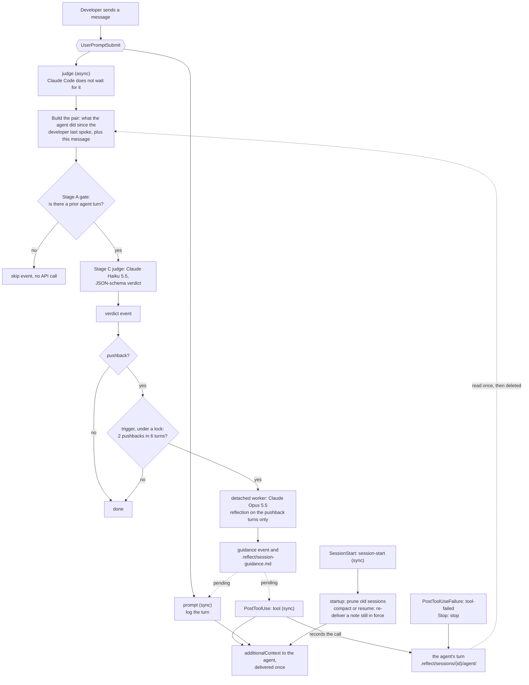

# How reflect works

reflect 0.2 is a Claude Code plugin that watches how the developer responds to the agent. When two of the developer's messages in a short stretch are pushback (a correction, a rejection or a report that something is broken), a stronger model reads those turns and writes a short note. The agent receives the note before its next step.

Everything runs from one TypeScript source tree in `src/`. `scripts/build-hook.mjs` bundles it into `plugin/hooks/reflect-hook.mjs`, which is committed, and the npm `reflect` bin is that same file. The installable plugin is the `plugin/` folder: the manifest, `hooks/hooks.json`, the bundle, the `/brain-reflect` command, the plugin's README and its privacy policy. Nothing is kept between sessions, and nothing is written outside the project's `.reflect/` directory.

## The hook flow

`plugin/hooks/hooks.json` registers six hook commands, all of the form `node ${CLAUDE_PLUGIN_ROOT}/hooks/reflect-hook.mjs <mode>`. The dispatch is in `src/hook/main.ts`; what each mode does is in `src/hook/run.ts`.

| mode | event | runs | does |
|---|---|---|---|
| `session-start` | SessionStart | sync, 10 s timeout | On `startup`, deletes session logs older than 7 days. On `compact` or `resume`, re-delivers guidance that is still in force. |
| `prompt` | UserPromptSubmit | sync, 10 s timeout | Appends a `prompt` event and delivers any pending guidance. |
| `judge` | UserPromptSubmit | `async: true` | Pair, gate, judge and trigger. A fire starts the reflection in a detached worker process. |
| `tool` | PostToolUse | sync, 10 s timeout | Records the tool's name and target for the judge, then delivers pending guidance in the middle of a turn, before the agent's next edit. |
| `tool-failed` | PostToolUseFailure | sync, 10 s timeout | Records the failed call. |
| `stop` | Stop | sync, 10 s timeout | Records the agent's final reply from `last_assistant_message`. |

A tool call with an `agent_id` comes from a subagent. It is not recorded and gets no guidance. Every mode exits 0. A hook never blocks a prompt or a tool call; an exception becomes an `error` event in the session log and nothing else.

## One developer message, step by step

This is `judgeTurn` in `src/hook/run.ts`.

1. **Budget and auth.** If the session has already spent its cap (`REFLECT_MAX_USD_PER_SESSION`, default $0.50) or an earlier call failed authentication, stop here.
2. **Pair.** `takeAgentTurn` in `src/hook/turns.ts` reads what the `tool`, `tool-failed` and `stop` hooks recorded since the developer's previous message, then deletes it. A bare `/compact` or another harness command is not the developer answering, so it is skipped and the agent's turn stays open across it. The pair has the same shape as the benchmark's, which `pairForPrompt` in `src/transcript/parse.ts` built from transcripts: tool names and targets, whether each changed a file or failed, and the agent's words. The hooks never read the transcript.
3. **Gate.** `src/detect/structural.ts` has one hard rule: if there is no agent turn before this message (a session opener, or a second message sent before the agent replied), skip without calling anything.
4. **Judge.** `src/detect/judge.ts` sends the pair to Claude Haiku 5.5 with a JSON-schema output format. The label is one of seven; `correction`, `rejection` and `failure_report` count as pushback, while `instruction`, `question`, `affirmation` and `other` do not. Thinking is off and effort is low. The `verdict` event keeps the label, confidence and cost. The message, the turn summary and the judge's quote and reason go to `turns/<prompt id>.json`, which only the developer's last 12 messages keep.
5. **Trigger.** `src/trigger/accumulator.ts` replays every verdict in the session through a sliding window counted in developer turns. The default policy `k2w6` fires on 2 pushbacks within 6 turns, then waits 3 turns before it can fire again. `REFLECT_POLICY` picks another: `each`, `k2w4`, `k2w8`, `k3w8` or `k2w6-med` (which ignores low-confidence verdicts).
6. **Reflection.** `src/reflect/reflection.ts` sends exactly the turns that tripped the trigger to Claude Opus 5.5. Each turn carries a summary of what the agent had just done, the developer's words and the span the judge quoted as evidence. The call uses adaptive thinking at effort `high`, and the server-side fallback beta, so a refusal is retried on a fallback model inside the same request. It runs in a separate process (`reflect-worker`) that the judge hook starts detached: `claude -p` ends the hook's process as soon as the agent answers, which in a short turn comes before the reflection does (a live test on 2026-11-16 lost its first note this way). If the worker cannot start, the judge hook runs the reflection itself. The output schema (`src/reflect/schema.ts`) has `pattern`, `signal`, `adjustment`, `confidence`, `scope`, `false_trigger_likelihood`, `counter_hypothesis`, `verify` and `expires_after_turns` (3 to 12).
7. **Delivery.** `src/reflect/format.ts` turns the reflection into at most 2,400 characters of `additionalContext`. The next `tool` or `prompt` hook hands it to the agent and records a `delivered` event, so it arrives once. The same hook output carries a `systemMessage` with the whole note, so the developer sees exactly what the agent was told, and a copy goes to `.reflect/session-guidance.md`.

`reflect manual` does not wait for the trigger. It sends the last N judged turns whose text is still kept (default 6, at most 12) to the reflection model and tells it some of them may not be pushback. It does not check the spend cap. The plugin's `/reflect:brain-reflect` makes no API call: it lists which of those turns read as pushback, with the judge's quotes, and asks the agent to reflect on them.

## Design decisions

### Judge the pair

The same words can be an instruction or a correction depending on where they sit. "Don't touch the tests" at the start of a task is a guardrail; right after the agent edited a test file, it is a correction. So the judge sees the agent's previous turn (its last 14 tool calls with their targets, and the last 1,400 characters of what it said) next to the developer's message (up to 2,500 characters).

The benchmark tested this with a control that could have refuted it. With the agent's turn removed, the judge lost 10.3 F1 points, nearly all of it recall. With another pair's agent turn put in the same slot, it lost 27.6 (`bench/FINDINGS.md` §4). The interval on the 10.3 is wide, and the section says so.

### Gate, then judge

The judge costs money on every message, so a free check runs first. Stage A reads no words, which is why it works in any language. Only its hard rule is used in the hook: no prior agent turn means there is nothing to push back on. With that gate (θ 0) in front of the judge, the benchmark measured 97.4% precision, 53.9% recall and 83.9% F0.5 per turn with Claude Haiku 5.5, against 87.0%, 47.5% and 74.6% for the Claude Haiku 4.5 judge of August. The gate's softer scores, which would skip more calls, are computed but not used; the threshold that would apply them was chosen in-sample, and raising it lowered recall.

On turns that follow code edits, the gate removes almost nothing (`bench/FINDINGS.md` §6). Its savings come from session openers and non-coding work.

### Wait for two pushbacks

A single correction is already in the agent's context, word for word, so a reflection on it adds little. Two inside a short window suggest something the agent is not seeing across turns, which is what an outside reader can name. Replaying the policies over the August sessions with the Haiku 5.5 verdicts (`bench/results/session-sim-h55.md`), `k2w6` fired 21 times, every time on turns the reference labels also call pushback, in 17 sessions: session precision 100% and session recall 65.4%. With the Haiku 4.5 verdicts it fired 20 times, 17 of them supported, with session precision 93.8% and recall 57.7%. Both tables were computed on the same data the default was chosen on.

The 0.1 trigger summed weighted signals into an integer that never decayed and fired at 240. It fired zero times over 109 sessions in July (`evals/FINDINGS.md`).

### An outside model writes the reflection

The agent being corrected is a poor judge of why. The reflection model sees only the pushback turns, without the rest of the session, and is asked for the cause they share. It must also give its best alternative reading (`counter_hypothesis`) and one cheap check the agent can run first (`verify`). When it reports low confidence or a high false-trigger likelihood, the note tells the agent to ask the developer before acting on the adjustment. Every note ends by saying the developer's own words in the current turn take precedence.

Opus 5.5 is the default because it runs rarely: one reflection per fire, against a judge call on most messages.

### Deliver once, then let it expire

The note goes in through `additionalContext` on the first `tool` or `prompt` hook after it is written, and a `delivered` event stops it from being sent again. It stays "in force" for `expires_after_turns` developer turns. If Claude Code compacts or resumes the session in that window, `session-start` delivers it again, because compaction rewrites the context it was delivered into. After the window it is dropped. 0.1 wrote a markdown file and relied on a path-scoped rule to get the agent to read it.

### An append-only log per session

State lives in `.reflect/sessions/<session_id>/events.jsonl`, one JSON line per event: `prompt`, `verdict`, `skip`, `fire`, `guidance`, `delivered` and `error`. Status, spend and pending guidance are all derived by reading the log back (`src/hook/state.ts`). Since 0.2.2 the log holds no message text. That lives next to it, in `agent/` until the judge has read a turn and in `turns/` for the developer's last 12 messages (`src/hook/turns.ts`). 0.1 kept one JSON object per project and rewrote it from two hooks with `grep` and `sed`. PostToolUse fires once per parallel tool call, so those writers lost updates.

The one step that reads, decides and writes is the trigger. It runs under an exclusive-create lock file (`fire.lock`, treated as stale after 120 s), so two judges finishing together cannot both fire on the same pattern. The reflection runs outside the lock, in the worker, and a claim file (`reflecting-<id>`) makes sure one fire gets one reflection.

`.reflect/` gets its own `.gitignore` containing `*` on first write. `reflect off` writes `.reflect/disabled`.

### One bundled hook

A plugin install copies the `plugin/` folder: there is no `npm install` and no build step on the user's machine. So the hook ships as committed ES modules with the Anthropic SDK inside them, and the package has no runtime dependencies. The entry file is about 48 KB. `src/api/client.ts` loads the SDK in three pieces, the client core, the Messages API and the beta Messages API, and only the judge and the reflection load them, so the `prompt`, `tool` and `session-start` hooks, which run on every message and tool call, never parse the SDK. Loaded that way, the bundler keeps only the parts reflect calls (about 530 KB in all, against 1.3 MB for the whole SDK), and no file passes 256 KiB, the size at which Anthropic's plugin directory holds a file for a reviewer. The build fails if one does. The build also swaps the SDK's agent toolset module, which reflect never calls and which carries shell and download code, for an empty module. `npm run check:bundle` fails CI if the committed bundle does not match `src/`.

0.1 had the same detector in five implementations (two bash hooks, two PowerShell hooks and a TypeScript reference), documented as divergent.

## Credentials and spend

As an installed plugin, reflect uses one credential, the plugin's `anthropic_api_key` setting, and sends it only to `https://api.anthropic.com`. Claude Code sets `CLAUDE_PLUGIN_ROOT` for a plugin's hooks, which is how they know; the plugin's command passes `--plugin` because commands do not get that variable. In that mode reflect does not read the project's `.env`, the plugin's settings take precedence over `REFLECT_MODEL` and `REFLECT_MAX_USD_PER_SESSION`, and `src/api/client.ts` removes every `ANTHROPIC_*` variable from the process before it creates the client, so the SDK cannot pick up a base URL, custom headers or another key from the environment. Outside the plugin, the key comes from, in order: `ANTHROPIC_API_KEY` in the environment, the project's `.env` (only `ANTHROPIC_API_KEY` and `REFLECT_*` are read from it, and they never override the environment), the plugin setting, and then whatever the SDK finds on its own, such as an `ant auth login` profile. A Claude subscription login alone does not give the hooks an API key. If the judge fails authentication (a 401 or 403, or no key found), the hooks make no more API calls in that session.

Each `verdict` and `guidance` event records its cost from `src/pricing.ts`; a model the table does not list is charged at the table's highest rate. The cap is checked before each judge call and again before each reflection, so only judge calls already in flight can take a session past it. Estimates are in [`docs/cost.md`](docs/cost.md).

## Known limits

The measured numbers come from `bench/FINDINGS.md` (August 2026, with the judge rerun on Haiku 5.5 in November). §11 of that document lists its limits; these are the ones that matter for reading this page.

- **Few sessions.** The default trigger's replay rests on 21 fires and 26 target sessions. The 95% interval for 21 supported fires out of 21 runs from 85% to 100%.
- **The reference is a gold proxy.** Claude Opus 5 labelled the 837 turns. No human has checked them, so "precision" means agreement with Opus 5.
- **One developer, one language pair.** The corpus is 224 sessions from one person writing in Korean and English. The precision and recall figures may not transfer.
- **Duplicates.** The 837 rows hold 685 distinct prompts (the largest group is 30 identical automated health checks), so the effective sample is smaller than 837.
- **Chosen in-sample.** The gate setting and the `k2w6` default were both picked on the rows that report the result.
- **Main thread only.** Subagent transcripts were excluded from the benchmark, and the hooks ignore subagent tool calls.
- **The agent's words.** The benchmark's pairs took the agent's text from the transcript, including what it wrote between tool calls. Since 0.2.2 the hooks see only its final reply, so after a short final reply the judge sees less than it did in the benchmark. This has not been measured.
- **Detection only.** Whether a reflection makes the next turns better has not been tested.

Some limits are in the design itself:

- Recall is about half. The judge's errors run one way: it reads corrections as instructions (`bench/FINDINGS.md` §9). That keeps false interruptions low, and it caps how many patterns reflect can see.
- The gate cannot see a correction aimed at work from two turns back, for example a second message sent before the agent replied.
- The judge runs asynchronously, so a note written after message N reaches the agent at its next tool call at the earliest, while it is already working on N.
- Nothing persists across sessions. A pattern that recurs every session has to be found again each time; `scope: wider_concern` only suggests recording it in `CLAUDE.md`.

The 0.1 design documents are in [`docs/v0.1/`](docs/v0.1/README.md).
